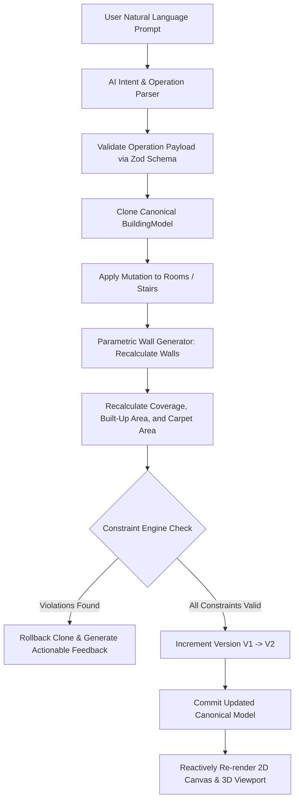

# AI Copilot System & Parametric Mutations

`@buildplanner/ai-engine` bridges natural-language user intent with the canonical parametric model.

Instead of generating non-deterministic images or raw unchecked code, the AI Copilot acts as an **expert parametric operator** that compiles user requests into formal, schema-validated mutations.

---

## 1. Typed AI Operation Schemas

All model alterations are strictly defined using Zod discriminated unions:

```typescript
export const AIOperationSchema = z.discriminatedUnion('operation', [
  ResizeRoomOpSchema,     // { operation: 'RESIZE_ROOM', parameters: { roomId, widthMm, lengthMm } }
  MoveRoomOpSchema,       // { operation: 'MOVE_ROOM', parameters: { roomId, dxMm, dyMm } }
  AddRoomOpSchema,        // { operation: 'ADD_ROOM', parameters: { levelIndex, name, type, widthMm, lengthMm, zone } }
  DeleteRoomOpSchema,     // { operation: 'DELETE_ROOM', parameters: { roomId } }
  ChangeStairOpSchema     // { operation: 'CHANGE_STAIRCASE_TYPE', parameters: { stairId, type } }
]);
```

---

## 2. Self-Correction & Validation Loop

When the user gives an instruction (e.g. *"Make Master Bedroom 12 by 14 feet"*), the system executes a safe atomic mutation cycle:



### 2.1 The Collision Prevention Example
In the Bhubaneswar G+1 Villa scenario:
- If a user prompts: *"Make Master Bedroom 16 by 16 feet"*, the bedroom would expand beyond the statutory setback boundary and collide with the adjacent circulation core.
- The Constraint Engine detects the collision (`ROOM_OVERLAP` or `OUTSIDE_BUILDABLE_ENVELOPE`).
- The system prevents model corruption and returns:
  > *"Could not resize 'Master Bedroom': Spatial collision with adjacent spaces or statutory setbacks. Please select smaller dimensions or adjust adjacent spaces first."*

---

## 3. Providers

### 3.1 `MockAIProvider` (Deterministic Offline Engine)
- Zero external API dependencies or costs.
- Pattern-matches architectural instructions:
  - *"Make master bedroom 12 by 14 feet"* $\to$ Resizes master bedroom, recalculates walls and areas.
  - *"Make staircase straight"* $\to$ Updates staircase model from Dog-Legged to Straight Flight.
  - *"Add a balcony to first floor"* $\to$ Synthesizes outdoor perimeter space.
  - General Vastu or architectural questions $\to$ Provides contextual design advice.

### 3.2 Production LLM Integration
In production, the backend prompts OpenAI (`gpt-4o`) or Anthropic (`claude-3-5-sonnet`) with:
1. The full current canonical `BuildingModel` JSON.
2. The active level index and user query.
3. System prompt enforcing JSON output conforming to `AIOperationSchema`.
4. The 3-attempt validation correction loop: If the mutation fails `validateBuildingConstraints`, the error message is fed back to the LLM to self-correct dimensions.
