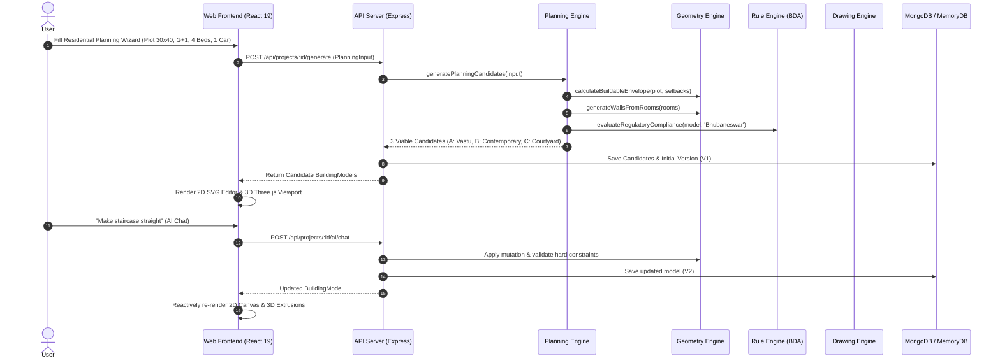

# BuildPlanner AI — System Architecture

**Tagline**: *"Describe your property. Build your plan."*

## 1. Executive Summary

BuildPlanner AI is an end-to-end parametric architectural planning platform designed for homeowners, architects, structural engineers, builders, and real-estate developers. 

Unlike prompt-to-image or ungrounded generative AI tools that hallucinate non-viable floor plans, impossible dimensions, and non-conforming structures, BuildPlanner AI adheres strictly to the **Computational Geometry Pipeline**:

$$\text{User Requirements} \longrightarrow \text{Deterministic Planning Engine} \longrightarrow \text{Parametric Geometry Engine} \longrightarrow \text{Canonical BuildingModel}$$

$$\text{Canonical BuildingModel} \longrightarrow \begin{cases} \text{Interactive 2D SVG Canvas (Pan, Zoom, Snap)} \\ \text{Interactive 3D Three.js Viewport (WebGL Extrusions)} \\ \text{Rule Engine (BDA / OBRPS 2020 Compliance)} \\ \text{Constraint Engine (NBC 2016 & Vastu Analysis)} \\ \text{Vector Drawing Engine (SVG / PDF / DXF Exports)} \\ \text{AI Architectural Copilot (Parametric Mutations)} \end{cases}$$

Every render target (2D floor plan, 3D viewport, export drawing, rule validator, and AI mutation) reads from and writes to a single source of truth: the **Canonical `BuildingModel`**.

---

## 2. Core Architectural Principles

1. **Deterministic Geometry over Hallucination**:
   - Rooms are polygons with explicit coordinates in millimeters.
   - Walls are parametrically deduced from room boundaries with automatic edge-sharing deduplication.
   - Staircases, doors, windows, and parking bays possess physically verified clearances and riser/tread physics.
2. **Canonical Single Source of Truth**:
   - A single JSON schema defines the entire building lifecycle.
   - No separate coordinate systems between 2D and 3D.
   - The 2D canvas, 3D viewport, and export generators are pure projection functions of the canonical model.
3. **Rigorous Regulatory Compliance**:
   - Never hallucinate non-existent building bye-laws.
   - Explicit verification for Bhubaneswar Development Authority (BDA / OBRPS 2020) and National Building Code of India (NBC 2016).
   - Any unverified jurisdiction outputs `UNKNOWN` with an explicit disclaimer.
4. **Resilient AI Copilot Loop**:
   - Natural language prompts are translated into structured, typed mutation operations (`RESIZE_ROOM`, `MOVE_ROOM`, `ADD_ROOM`, `DELETE_ROOM`, `CHANGE_STAIRCASE_TYPE`).
   - Mutations are verified against hard geometric constraints before being committed.
   - Self-correction loop rejects operations that introduce spatial collisions or setback encroachments.
5. **Zero-Setup Local Development**:
   - Embedded `mongodb-memory-server` provides instant out-of-the-box local execution without external database setup.
   - Full MongoDB Atlas connection strings supported in production.

---

## 3. Monorepo Architecture

The platform is structured as a pnpm workspace monorepo:

```
buildplanner-ai/
├── apps/
│   ├── api/                     # Express REST backend (Node.js, TypeScript, Mongoose)
│   └── web/                     # React 19 SPA (Vite, Tailwind CSS, Three.js, Zustand)
├── packages/
│   ├── units/                   # Millimeter standard, composite ft-in parser & unit converters
│   ├── shared/                  # Error classes, standard disclaimers, API response contracts
│   ├── building-model/          # Canonical BuildingModel schema (Zod) and type definitions
│   ├── geometry-engine/         # 2D Point/Polygon math, wall deduction, openings, stairs
│   ├── constraint-engine/       # Hard geometric constraints, NBC 2016 standards, 9-zone Vastu
│   ├── rule-engine/             # Bhubaneswar BDA/OBRPS 2020 regulatory compliance
│   ├── planning-engine/         # Deterministic candidate layout generator (Candidate A, B, C)
│   ├── ai-engine/               # Typed AI operation execution, prompt parsing, self-correction
│   └── drawing-engine/          # Procedural 2D SVG floor plans, North/West orthographic elevations
├── docs/                        # Comprehensive technical documentation
├── tests/                       # End-to-end integration and scenario acceptance suites
├── docker-compose.yml           # Production multi-container orchestration
└── package.json                 # Monorepo root configuration
```

---

## 4. Data Flow Lifecycle



---

## 5. Technology Stack Summary

| Layer | Technology | Rationale |
| :--- | :--- | :--- |
| **Monorepo Manager** | pnpm 12 Workspaces | Fast, disk-efficient symlink-based dependency management |
| **Language** | TypeScript 5.7+ | Strict typing across shared models and client/server boundaries |
| **Frontend Framework** | React 19 + Vite 6 | Lightning-fast HMR and reactive modern frontend |
| **Styling** | Tailwind CSS 3.4 | Utility-first architectural blueprint dark-mode theme |
| **3D Engine** | Three.js 0.173 | Pure WebGL hardware-accelerated parametric building extrusions |
| **State Management** | Zustand 5 | Lightweight, decoupled reactive store for canvas and view states |
| **Server Framework** | Express 4 + Helmet + Pino | Production-grade API server with structured logging and security |
| **Database** | Mongoose + MongoMemoryServer | Flexible JSON document storage with zero-config local fallback |
| **Testing** | Vitest 2.1 | Blazing-fast unified unit, integration, and scenario runner |
